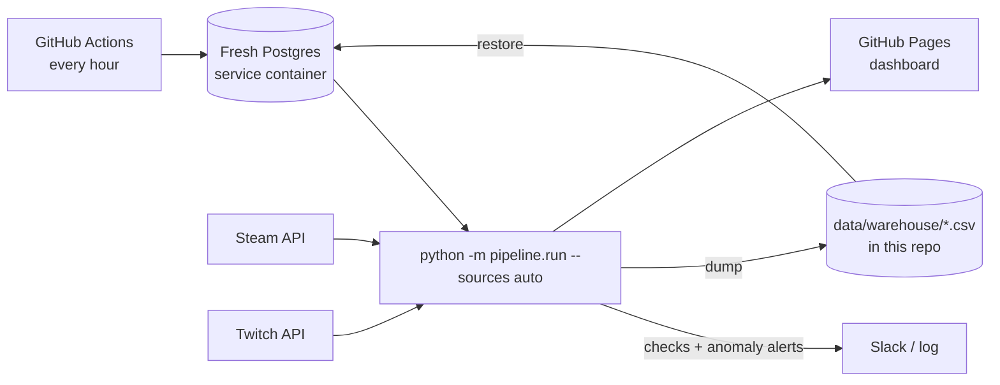
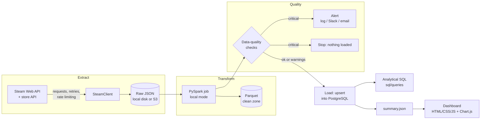

# game-data-pipeline

[](https://github.com/amyvwhite/game-data-pipeline/actions/workflows/live.yml)
[](https://github.com/amyvwhite/game-data-pipeline/actions/workflows/ci.yml)

**Live dashboard: https://amyvwhite.github.io/game-data-pipeline/**

A data pipeline that runs **every hour, on its own**, tracking Take-Two games on Steam
against four competitors: live player counts, prices, reviews and Twitch viewers. It
cleans the data with PySpark, checks its quality, loads it into PostgreSQL, finds
unusual player counts and sends alerts, and publishes a dashboard.

**Questions it answers:**

- What share of players across these 11 games are in Take-Two titles, day by day?
- When is each game busiest (by hour, Toronto time)?
- Do sales bring players back? (players on sale days vs full-price days)
- Is anything unusual happening right now? (a spike or drop vs that game's normal level for that time of day)
- Does Twitch attention line up with players?
- **GTA VI launch watch:** GTA VI launches on PS5/Xbox on Nov 19, 2026 and isn't on Steam, so
  the pipeline tracks its Twitch viewers from day one and compares each Take-Two game's
  Steam players with the week before launch. Does the new game pull players away from GTA V?

**Games:** GTA V (Enhanced and Legacy), Red Dead Redemption 2, NBA 2K26, Borderlands 4,
Civilization VI and VII, plus EA Sports FC 26, Call of Duty, Assassin's Creed Shadows and
Cyberpunk 2077 as competitors, plus GTA VI on Twitch only (`"steam": false`). The list lives
in `config/apps.json`.

## How it runs live, for free



There's no always-on server or database. Each hourly run (`.github/workflows/live.yml`)
starts a fresh Postgres, restores the full history from CSV files in this repo, runs
the pipeline, dumps the tables back out and commits them, then publishes the dashboard
to GitHub Pages. Git is the storage layer, so every hour's change is in the commit
history. `--sources auto` fetches player counts and Twitch every hour, and the slower
store and review calls once a day.

## What it collects

| Data | Steam endpoint | Key needed? |
|---|---|---|
| Current players | `GET https://api.steampowered.com/ISteamUserStats/GetNumberOfCurrentPlayers/v1/?appid=<id>` | No |
| Name, publisher, price, discount | `GET https://store.steampowered.com/api/appdetails?appids=<id>&cc=ca` (store endpoint; not officially documented, widely used) | No |
| Review totals and score | `GET https://api.steampowered.com/IUserReviewsService/GetAppReviews/v1/?input_json={...}` | No (optional) |

For reviews I use `IUserReviewsService/GetAppReviews`, because Valve's docs mark the
older `store.steampowered.com/appreviews/<id>?json=1` endpoint as deprecated.

Prices come back in cents (for example `7999` = CA$79.99), and I store them that way.

## How it works



One command runs the whole thing: `python -m pipeline.run`.

1. **Extract** (`pipeline/extract/`): calls Steam for each game and saves each response
   untouched, inside a small envelope (app id, fetch time). The client has timeouts,
   exponential backoff, handles HTTP 429 (and respects `Retry-After`), and spaces
   requests out because the store API allows roughly 200 requests per 5 minutes. One
   failing game doesn't stop the others. Raw files go to `data/raw/<source>/dt=YYYY-MM-DD/`
   locally, or to S3 when `STORAGE_BACKEND=s3`.
2. **Transform** (`pipeline/transform/spark_job.py`): a PySpark job with explicit schemas
   builds five clean tables: `apps`, `player_count_snapshots`, `player_counts_daily`,
   `app_prices` and `review_summary`. If something was fetched twice in a day, a window
   function keeps the latest. It also writes Parquet partitioned by date.
3. **Quality** (`pipeline/quality/`): checks row counts, nulls, duplicate keys, freshness,
   missing games, impossible values (negative players, discounts over 100%, review
   totals that don't add up), and gaps in the last 7 days. Critical failures send an
   alert and stop the run before anything is loaded (exit code 1). Warnings alert but
   continue.
4. **Load** (`pipeline/load/`): upserts into Postgres (`INSERT ... ON CONFLICT DO UPDATE`)
   in one transaction, so re-running a day is safe. Each run is logged in `pipeline_runs`.
5. **Export + dashboard** (`pipeline/export.py`, `dashboard/`): writes
   `dashboard/data/summary.json`, which a plain HTML/CSS/JS page charts with Chart.js.

## Project layout

```
pipeline/
  config.py              settings from env vars / .env
  run.py                 entry point: extract -> transform -> quality -> load -> export
  extract/               Steam client, raw storage (local + S3)
  transform/             PySpark job
  quality/               checks + alerts
  load/                  Postgres loader
  export.py              JSON summary for the dashboard
sql/
  schema.sql             tables, keys, constraints, indexes
  queries/               12 analytical queries (CTEs, window functions, LATERAL, CORR)
dashboard/               static page (index.html, style.css, app.js)
config/apps.json         which games to track
scripts/seed_demo_data.py  SYNTHETIC history for demos
tests/                   pytest, with fixture JSON in tests/fixtures/
```

## Run it locally

You need Python 3.11+ and Java 17+ (for Spark). Postgres is easiest through Docker.

```bash
pip install -r requirements-dev.txt
cp .env.example .env

# Start just the database
docker compose up -d db

# Run for today: calls Steam, transforms, checks, loads, exports
python -m pipeline.run

# Look at the dashboard
python -m http.server 8000 --directory dashboard   # open http://localhost:8000
```

Other useful options:

```bash
python -m pipeline.run --skip-load                    # no database needed
python -m pipeline.run --sources players              # just player counts (good as an hourly job)
python -m pipeline.run --date 2026-11-18 --skip-extract   # re-process raw data you already saved
```

Steam only reports *current* numbers, so the pipeline refuses to extract for a past
date. You can't backfill real history. To see the charts and SQL with some history
right away, there's a demo script that writes **synthetic** data (every raw file is
marked `"synthetic": true` and the dashboard shows a banner):

```bash
python scripts/seed_demo_data.py --days 21 --run
```

The `dashboard/data/summary.json` checked into the repo was made this way.

## Run it with Docker

```bash
docker compose up --build
```

This starts Postgres, runs the pipeline once for today, and serves the dashboard on
http://localhost:8000. To run it again: `docker compose run --rm pipeline`.

## Use S3 for raw data

Set these in `.env`:

```bash
STORAGE_BACKEND=s3
S3_BUCKET=your-bucket
S3_PREFIX=game-data-pipeline
AWS_REGION=ca-central-1
```

Credentials come from the normal AWS chain (`aws configure`, environment variables, or
an IAM role on AWS). They're never in the code. For now, the Spark step copies that
day's raw files from S3 to a temp folder before reading them. Reading `s3a://` directly
is on the roadmap.

## Example SQL

All queries are in [`sql/queries/`](sql/queries/), and each one has comments explaining
the question it answers and the SQL ideas it uses:

| File | What it shows |
|---|---|
| `01_day_over_day_players.sql` | `LAG()` day-over-day change, handling skipped days correctly |
| `02_rolling_7day_average.sql` | rolling averages with window frames, spike/drop flags |
| `03_daily_rank.sql` | `RANK()` vs `DENSE_RANK()`, rank movement (window on a window) |
| `04_price_changes.sql` | detecting when sales start and end |
| `05_peak_hours.sql` | busiest hour in Toronto time, `AT TIME ZONE`, `ROW_NUMBER()`, `FILTER` |
| `06_review_trend.sql` | new reviews per day from running totals, recent vs all-time sentiment |
| `07_sale_impact.sql` | players on sale days vs full-price days (conditional aggregation) |
| `08_data_coverage.sql` | missing days per game with `generate_series` and an anti-join |
| `09_player_anomalies.sql` | spike/drop detection: z-score vs same-time-of-day baseline using `LATERAL` and `STDDEV_SAMP` |
| `10_market_share.sql` | Take-Two vs competitors share of players, `SUM() OVER (PARTITION BY ...)` |
| `12_gta6_launch_watch.sql` | Take-Two Steam players vs the week before GTA VI's launch, next to GTA VI Twitch viewers (a `params` CTE, relative baselines) |
| `11_twitch_vs_players.sql` | nearest-in-time join with `LATERAL ... LIMIT 1`, `CORR()` between viewers and players |

For example, price-change detection:

```sql
WITH priced AS (
    SELECT app_id, snapshot_date, final_price_cents, discount_percent,
           LAG(final_price_cents) OVER w AS prev_final_cents,
           LAG(discount_percent)  OVER w AS prev_discount
    FROM app_prices
    WINDOW w AS (PARTITION BY app_id ORDER BY snapshot_date)
)
SELECT app_id, snapshot_date,
       CASE WHEN prev_discount = 0 AND discount_percent > 0 THEN 'sale started'
            WHEN prev_discount > 0 AND discount_percent = 0 THEN 'sale ended'
            ELSE 'price changed' END AS change_type
FROM priced
WHERE prev_final_cents IS NOT NULL
  AND (final_price_cents <> prev_final_cents OR discount_percent <> prev_discount);
```

Run any of them with `psql "$DATABASE_URL" -f sql/queries/04_price_changes.sql`.

## Tests

```bash
pytest                 # unit tests; Postgres tests skip unless TEST_DATABASE_URL is set
make test-all          # also runs the Postgres integration tests against docker compose
```

- Steam is never called in tests. HTTP is mocked with `responses`, using realistic
  fixture JSON in `tests/fixtures/`. The numbers in the fixtures are made up.
- The S3 store is tested against `moto` (a fake S3).
- Spark tests run Spark in local mode. They skip themselves if Java/PySpark aren't installed.
- The Postgres integration tests load sample history and check that **every query in
  `sql/queries/` runs**, that loads are idempotent, and that price-change detection
  finds the sale. Be careful: they drop and recreate tables, so point them at a test database.

CI (`.github/workflows/ci.yml`) runs ruff, then the full test suite with a Postgres
service container and Java 17, then builds the Docker image. There's also a
`Jenkinsfile` with the same stages, because many teams use Jenkins.

## What works today

- **Live, hourly, against real Steam data.** The first real run caught a real data issue:
  GTA V Legacy is no longer sold on its own, so Steam sends no price. The quality check
  stopped the load, as designed. I changed the model to record "not sold separately"
  explicitly, while a missing price on a game that *is* for sale still fails the run.
- **Anomaly detection** (`sql/queries/09_player_anomalies.sql`): each new snapshot is compared
  with the same game at the same time of day over the last 14 days (falling back to the
  last 72 hours while history is short). It flags results 3+ standard deviations and
  20%+ away from normal, and alerts once per anomaly.
- **Fixed a time-zone bug:** PySpark returns timestamps in the machine's local time zone,
  which shifted hours on a non-UTC laptop. Timestamps are now explicitly UTC, with a test
  that runs in Toronto time.
- **Tests:** 76 unit and integration tests (Spark transforms, quality rules, the Steam and
  Twitch clients with mocked HTTP, Postgres loads, every SQL query, anomaly detection,
  and the warehouse dump and restore round trip). Lint clean.
- **Docker** (`docker compose up`) for running locally, plus an hourly Windows Task
  Scheduler option (`START_HOURLY_COLLECTION.bat`).

Known limits, on purpose:

- Steam only reports *current* numbers, so history starts the day collection started.
  You can't backfill it.
- Twitch viewers are summed over the top 1,000 live streams per game. The runs record
  when a game had more streams than that (`truncated`).
- GitHub may start scheduled runs a few minutes late, and pauses schedules on repos
  with no activity for 60 days. The hourly data commits count as activity.

## Roadmap / next steps

- [ ] Move from CSV-in-git to a hosted Postgres (or S3 + Athena) once the history gets large.
- [ ] Read `s3a://` directly from Spark (hadoop-aws) instead of copying files locally.
- [ ] Orchestrate with Airflow (or Step Functions), with retries and backfills per task.
- [ ] Explain anomalies automatically: match spikes to Steam news/patch notes and sales.
- [ ] Track regional prices (`cc=us`, `gb`, ...) and currency conversion.
- [ ] dbt models on top of the Postgres tables; incremental loads.

## Licence

Copyright (c) 2026 Amy V White. All rights reserved. See [LICENSE](LICENSE). The code
is public so it can be viewed as part of my portfolio; it is not open source.
